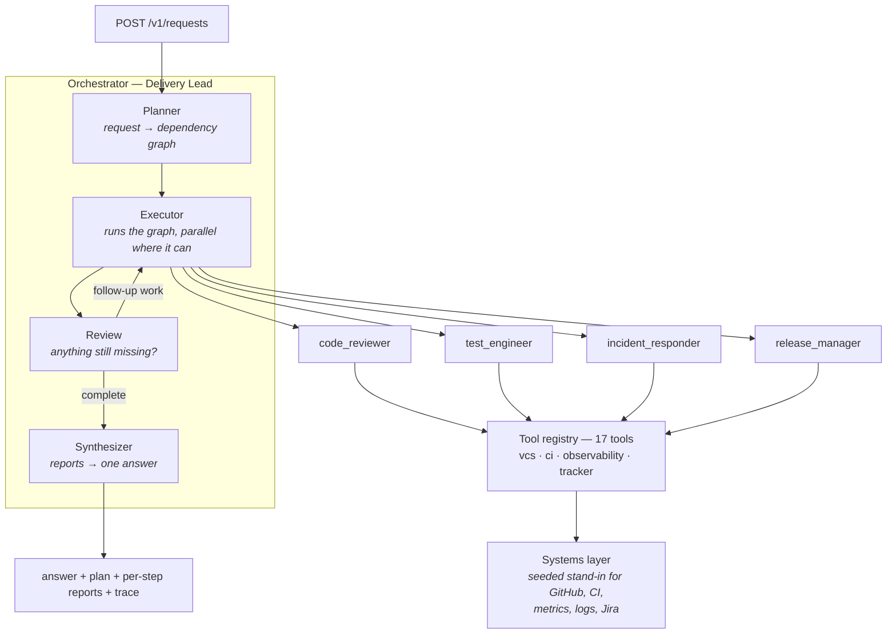

# multi-agent-ops

A multi-agent system for a software delivery team, built with **Python**, **FastAPI** and
**OpenAI**.

One **orchestrator** — the Delivery Lead — reads a request in plain language, breaks it into a
dependency graph of delegations, runs the independent ones in parallel, reviews what comes back,
and writes a single answer. Four **specialists** do the actual work: each has its own prompt, its
own tools, its own bounded tool-calling loop, and no access to anything outside its mandate.

It is modelled on how a real delivery team handles a question like *"can PR 482 go into Thursday's
release?"*: the tech lead does not answer that alone, and does not ask everyone everything.

```
POST /v1/requests
  "PR 482 on checkout-api is up for review and we want it in Thursday's release.
   Is it safe to merge, what tests does it still need, and can the release go out?"
```

```
▶ orchestrator    plan: three questions, two of them independent
→ code_reviewer   [s1] Review PR 482 for correctness          ⎤ in parallel
→ test_engineer   [s2] Assess coverage and name missing tests ⎦
  ⚙ get_pull_request · get_ci_runs · get_test_suite · get_coverage_report
✓ code_reviewer   [s1] request-changes: idempotency insert races
✓ test_engineer   [s2] coverage 81.4% vs 84.2% baseline, concurrency path untested
→ release_manager [s3] Go/no-go for 2.14.0        (waits for s1 and s2)
∑ orchestrator    combining 3 specialist reports
■ orchestrator    run succeeded
```

---

## How it works



A request goes through four phases:

1. **Plan.** The orchestrator sees only each specialist's *mandate*, not its tools or prompt, and
   returns JSON: a list of steps, each with an agent, a self-contained objective, and the steps it
   depends on. The plan is validated before anything runs — unknown agent, dangling dependency,
   dependency cycle, empty objective or too many steps are all rejected, and the model gets exactly
   one chance to repair it.
2. **Execute.** Steps whose dependencies are satisfied run concurrently, capped by
   `MAX_PARALLEL_STEPS`. Each specialist runs its own tool-calling loop; a step's report is handed
   to whatever depends on it. A step that fails or times out causes its dependents to be **skipped**,
   not run on missing input — the run finishes as `partial` instead of collapsing.
3. **Review.** The orchestrator reads the results and may schedule one more round of work
   (`MAX_REPLAN_ROUNDS`). This is how "the review found a gap, now write the test for it" happens
   without being hard-coded.
4. **Synthesize.** One answer, built only from what the specialists reported, naming anything that
   went unverified. A single report is passed through verbatim rather than paraphrased.

Every decision is published as a trace event, so `POST /v1/requests/stream` shows the plan, each
delegation and each tool call **as it happens** — see [ARCHITECTURE.md](ARCHITECTURE.md) for the
full lifecycle and the reasoning behind each choice.

---

## The team

The scenario is *Northwind Payments*, a payments org with three services (`checkout-api`,
`ledger-service`, `notification-worker`), open pull requests, a failing CI run, a live SEV2
incident and a release train on Thursdays.

| Agent | Role | Mandate | Tools |
|---|---|---|---|
| `code_reviewer` | Staff Engineer | Reads the diff and judges correctness, concurrency, data integrity and migration safety | 6 |
| `test_engineer` | Engineer in Test | Assesses coverage against the change and writes the missing tests in the repo's conventions | 5 |
| `incident_responder` | SRE on call | Correlates deploys, metrics and logs to find the cause and the fastest mitigation | 11 |
| `release_manager` | Release Manager | Verifies the release checklist against the real systems and drafts release notes | 10 |

Tools are **scoped per agent**. The release manager cannot read production logs; the code reviewer
cannot see the release checklist. If a model asks for a tool outside its mandate, the call is
refused and the refusal is fed back to it — enforced in code, not in the prompt
(`tests/test_agents.py::test_agent_cannot_reach_a_tool_outside_its_mandate`).

The systems layer behind the tools is seeded fixture data in
[`src/agentops/systems/data/seed.json`](src/agentops/systems/data/seed.json), designed so the
questions have real answers: PR 482 inserts an idempotency record with no unique-constraint
handling, its CI run fails on exactly that race, its coverage dropped below baseline, and INC-204 is
open on the same service — so "is this safe to merge and can we ship?" has a defensible answer the
agents have to find rather than guess. Swapping in the real GitHub, Datadog and Jira APIs means
rewriting one file: `src/agentops/systems/store.py`. Nothing above it changes.

---

## Quick start

### See it run without an API key

```bash
make demo
```

That executes a real orchestration — real planner, real DAG executor, real agent loops, real tools
against the seeded systems — with a scripted model standing in for OpenAI. No key, no network, no
tokens. It is the fastest way to follow the control flow.

### Run it for real

```bash
make install
cp .env.example .env    # then put your OPENAI_API_KEY in it
make run
```

Then, in another shell:

```bash
python scripts/demo.py "Review PR 482 on checkout-api and tell me if it is safe to merge."
```

Interactive API docs are at <http://localhost:8000/docs>.

### In Docker

```bash
OPENAI_API_KEY=sk-... docker compose up --build
```

### The console

Open <http://localhost:8000> (it redirects to `/ui/`). It is the same API drawn as a page, so what you
see live is what `GET /v1/runs/{id}` can replay later:

- **Plan** — the dependency graph of delegations, appearing as the Delivery Lead decides it.
  Independent steps share a column and are labelled *in parallel*; follow-up work from the review
  round is badged.
- **Each agent's work** — every tool call with its arguments, result and duration, plus the report it
  handed back. Failed and skipped steps say why.
- **Timeline** — one bar per delegation, so overlapping work is visible rather than claimed.
- **Stop** — closes the stream, which cancels the run on the server (covered by a test), so no
  further tokens are spent.
- **Recent runs** — click one to replay it; `/ui/?run=<id>` is a shareable link.

It is plain HTML, CSS and JavaScript served by the app itself: no build step, no CDN, and it works
in an air-gapped container. Everything a model or tool produced is escaped before it is rendered.
If the server has no `OPENAI_API_KEY`, the page asks for one and keeps it in the tab's memory only.

---

## API

| Method | Path | What it does |
|---|---|---|
| `POST` | `/v1/requests` | Plan, delegate, answer. Blocks until the run finishes. |
| `POST` | `/v1/requests/stream` | The same run, streamed as server-sent events. |
| `GET` | `/v1/runs` | Ids of recent runs, newest first. |
| `GET` | `/v1/runs/{run_id}` | A finished run with its full trace. |
| `GET` | `/v1/agents` | The roster: each agent's mandate and tools. |
| `GET` | `/v1/tools` | The tool catalogue, with which agents may call each one. |
| `GET` | `/healthz`, `/readyz` | Liveness and readiness. |

```bash
curl -s localhost:8000/v1/requests \
  -H 'content-type: application/json' \
  -d '{"request": "checkout-api is throwing 5xx since this morning. What happened and what do I do?"}' \
  | jq '{status, agents_used, answer}'
```

The response carries the answer **and the work behind it** — the plan, every step's full report,
which tools each agent called, token usage and timings:

```jsonc
{
  "run_id": "run_7f3a1c9b2e04",
  "status": "succeeded",
  "answer": "...",
  "agents_used": ["incident_responder"],
  "plan": { "reasoning": "...", "steps": [ { "id": "s1", "agent": "incident_responder", ... } ] },
  "steps": [ { "step_id": "s1", "status": "succeeded", "output": "...", "tools_called": [...] } ],
  "usage": { "total_tokens": 8120, "llm_calls": 4 },
  "duration_ms": 11840
}
```

Pass `"include_trace": true` for the event-by-event trace.

### Streaming

```bash
curl -N localhost:8000/v1/requests/stream \
  -H 'content-type: application/json' \
  -d '{"request": "Can 2.14.0 ship on Thursday?"}'
```

```
event: trace
data: {"seq":2,"type":"plan.created","agent":"orchestrator","message":"..."}

event: trace
data: {"seq":3,"type":"step.started","agent":"release_manager","step_id":"s1",...}

event: result
data: {"run_id":"run_7f3a1c9b2e04","status":"succeeded","answer":"...",...}
```

Trace events are sequenced, replayed to late subscribers, and de-duplicated across the replay
window, so a client that connects mid-run still sees the whole run exactly once. If the client
disconnects, the run is cancelled rather than left burning tokens.

### Bring your own key

Every endpoint accepts an `X-OpenAI-Key` header, which overrides the server's key for that request.
One deployment can serve several teams without sharing a billing account; clients are cached per
key and the cache is bounded.

---

## Configuration

All via environment variables — see [`.env.example`](.env.example).

| Variable | Default | What it controls |
|---|---|---|
| `OPENAI_API_KEY` | — | Server-side key. Optional if callers send `X-OpenAI-Key`. |
| `OPENAI_BASE_URL` | OpenAI | Point at Azure OpenAI, a gateway, or a local compatible server. |
| `ORCHESTRATOR_MODEL` | `gpt-4.1` | Planning and synthesis — the reasoning-heavy calls. |
| `AGENT_MODEL` | `gpt-4.1-mini` | The specialists. Most of the calls, so most of the cost. |
| `MAX_PLAN_STEPS` | `6` | Hard cap on delegations per plan. |
| `MAX_REPLAN_ROUNDS` | `1` | How many follow-up rounds the orchestrator may schedule. |
| `MAX_AGENT_ITERATIONS` | `6` | Tool-calling turns per specialist before it must report. |
| `MAX_PARALLEL_STEPS` | `4` | Concurrency cap across specialists. |
| `STEP_TIMEOUT_SECONDS` | `90` | Per-delegation wall clock. |
| `RUN_TIMEOUT_SECONDS` | `300` | Whole-run wall clock. |
| `LOG_FORMAT` | `json` | `json` for production, `text` for a readable local console. |

Each limit exists because an agentic system without it has an unbounded failure mode: a plan with
forty steps, a specialist looping on the same tool, a run that never returns. Exceeding one is
reported in the response, never silently swallowed.

---

## Extending it

**Add a specialist** — one file. Define an `Agent` with a mandate, instructions, an output contract
and the tools it may use, then add it to `DEFAULT_AGENTS` in
[`agents/registry.py`](src/agentops/agents/registry.py). The orchestrator picks it up from its
mandate; nothing else changes.

```python
SECURITY_AUDITOR = Agent(
    name="security_auditor",
    title="Application Security Engineer",
    mandate="Audits a change for injection, authz and secrets-handling flaws. Use for ...",
    instructions="...",
    output_contract="...",
    tool_names=["get_pull_request", "get_ci_runs"],
)
```

**Add a tool** — a name, a description the model reads, a JSON schema and a handler. Register it in
[`tools/catalog.py`](src/agentops/tools/catalog.py) and list it on whichever agents should have it.
Raise `ToolExecutionError` with `details` for a recoverable failure: the model reads the error and
usually corrects itself, which is why `get_service_metrics("nope")` returns the list of valid
service names instead of a stack trace.

**Swap the model provider** — implement `LLMClient` (one method). `OpenAIClient` and the scripted
`ScriptedLLM` used throughout the tests are the two existing implementations.

---

## Testing

```bash
make check      # ruff + mypy + the full suite
make cov        # with a coverage report
```

75 tests at 92% coverage, no network, no API key, under a second. The scripted LLM (`llm/fake.py`) matches on the
conversation and returns canned turns, so a whole multi-agent interaction — a plan, two parallel
specialists, their tool calls, a follow-up round, the synthesis — is described as data.

What that buys is tests for the things that actually go wrong in an agentic system, not just happy
paths: independent steps genuinely overlapping, the parallelism cap serialising them, an upstream
failure skipping its dependents while an unrelated step still succeeds, a step timeout degrading the
run to `partial`, a specialist exhausting its tool budget and being forced to report, a model asking
for a tool outside its mandate, an invalid plan being repaired exactly once, a dependency cycle
being refused, and a trace subscriber joining mid-run seeing every event exactly once.

---

## Layout

```
src/agentops/
├── main.py             FastAPI app factory
├── api/                routes, dependency wiring, error mapping
├── orchestrator/       planner · DAG executor · synthesizer · the run loop
├── agents/             the agent loop + one file per specialist
├── tools/              tool registry and the four tool domains
├── systems/            seeded stand-in for GitHub / CI / metrics / Jira
├── llm/                provider interface, OpenAI client, scripted fake
├── runtime/            trace event bus, run store
├── ui/                 the console: static HTML, CSS and JS served at /ui
└── core/               settings, logging, exceptions
```

---

## Notes

Production-shaped: provider abstraction, bounded retries with jittered backoff, per-request key
override, guardrails on every loop, graceful degradation to `partial`, structured JSON logs with
correlation ids, a full trace per run, non-root container with a health check, typed throughout,
CI across three Python versions.

Deliberately simulated: the systems layer is fixture data, and runs are stored in a bounded
in-memory dict. Both sit behind interfaces (`SystemsStore`, `RunStore`) so replacing them with real
integrations and Postgres is a contained change.

## Licence

MIT
